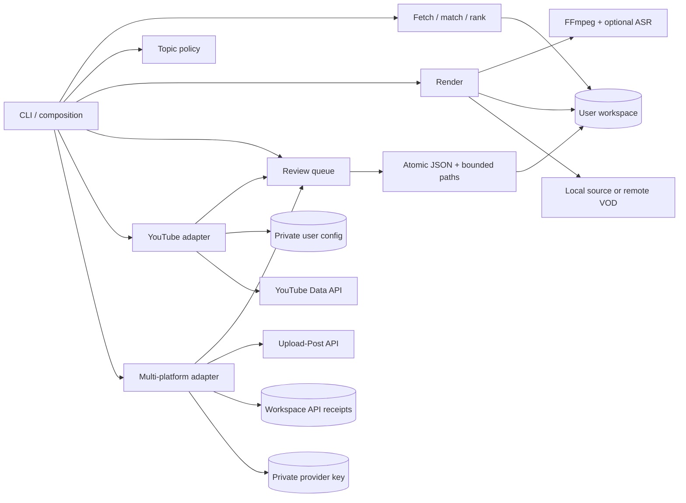

# Architecture

Zunara Studio is a modular CLI, not a web service. Its public interface is the `zunara` command and
the workspace queue. Platform SDKs stay behind adapters. Importing the package does not create
files, contact a platform, open a browser or load a speech model.



## Module boundaries

| Module | Responsibility | Must not do |
| --- | --- | --- |
| `cli` | Parse arguments, select services, return JSON/errors | Put tokens in output |
| `config` | Resolve portable config and data paths | Create files during import |
| `storage` | Atomic JSON replacement and workspace containment | Deserialize executable objects |
| `queue` | Discover media, record review hashes, export selected clips | Call platform APIs |
| `editorial` | Load and check the optional per-platform topic policy | Read workspaces or call platform APIs |
| `media` | Run bounded `ffprobe` inspection | Invoke a shell |
| `youtube` | OAuth, exact channel binding, previews, remote writes | Upload without explicit execution |
| `social` | Provider account binding, HTTP submission, receipts and status reconciliation | Infer success from an accepted request or silently retry unknown uploads |
| `signals`, `audio_match`, `rank_moments` | Audio/chat analysis and candidate ranking | Publish or claim editorial approval |
| `render` | Captions, layout and encoding | Decide which claims are accurate |
| `fetch_vod` | Optional acquisition into user-selected storage | Store downloads in the installed package |

The CLI is the composition boundary. New publishers should receive a queue selection, perform a full
preflight and expose preview separately from execution. No generic plugin registry or database is
needed for the current single-user workflow.

## Queue contract

`WORK/out/queue.json` is an array, one record per plain `.mp4` filename. Example:

```json
{
  "file": "first-clip.mp4",
  "title": "An unexpected answer",
  "description": "Source and context for this clip.",
  "tags": ["interview"],
  "topic": "programming",
  "sha256": "<computed SHA-256>",
  "approved_sha256": null,
  "youtube_id": null,
  "upload_state": "pending"
}
```

`topic` is optional and only matters when the topic policy restricts the destination platform.
`approved_sha256 = null` means unreviewed. Approval records the current media digest. A byte change
invalidates that approval. `youtube_id` is the platform's identifier after success. The adapter
writes `uploading` before starting a remote write and `uploaded` after receiving an ID. An
interrupted request remains ambiguous; it must be reconciled by a person against Studio before
retrying. This favors avoiding duplicate uploads over automatic recovery.

Writes use a temporary sibling file, flush, and atomic replacement. Publication is not a transaction
with YouTube: local state and the remote service cannot commit together. File locks coordinate queue
service writers; they do not prevent another application from changing media. Treat workspaces as
trusted local data and keep them unchanged during an upload. Export and upload use temporary media
copies whose hashes must match approval before they are handed to the destination. Exports become
visible as complete new directories and refuse to overwrite an existing batch.

A missing clip makes queue validation fail closed. Restore the clip, or back up `queue.json` and
remove its stale entry manually while no command is running. There is no automatic prune command.

## Topic policy contract

`CONFIG_DIR/publishing-policy.json` is optional: `{"platforms": {PLATFORM: {"allowed_topics":
[...]}}}`. Only `x`, `youtube`, `tiktok` and `instagram` are accepted. Unknown keys, empty lists and
topic names outside `[a-z0-9][a-z0-9_-]{0,63}` are errors. A missing file means no restriction. An
unreadable or malformed file fails closed.

The CLI enforces it. `export` checks the whole selected batch, under the workspace lock, before any
export directory is created. `publish` checks the clips that still need an upload before it opens
the YouTube client, so a denied batch never authenticates. `queue.export` and `youtube.upload` do
not read the policy; library callers must call `editorial.load_policy(config_dir).check(platform,
rows)` themselves. The policy is an editorial guard rail, not access control: anyone who can edit
the queue or the config file can change topics.

## Multi-platform API boundary

The optional Upload-Post adapter uses fixed HTTPS endpoints and a privately configured API key.
The CLI checks the existing topic policy for every destination before opening the adapter. Media
approval and expected connected-account identifiers are checked before any upload. A verified
temporary copy provides the upload bytes. Workspace receipts record intent before the remote write;
a dropped response stays unresolved so a later invocation cannot blindly resend it. The client
request ID and idempotency key are persisted before submission, allowing read-only reconciliation.

Provider scheduling and asynchronous processing live outside this process. Status refresh is a
read request, not a resubmission. Per-platform outcomes remain separate: a successful destination
does not make a failed one successful. These local records are not a transaction with the provider
or a global registry across workspaces. See the [API publishing guide](guides/social-api.md).

## Time and resources

Intervals use seconds; render starts are inclusive and ends exclusive. Schedules require an explicit
UTC offset. Upload completion timestamps are UTC. Model downloads, FFmpeg and remote VOD endpoints
are runtime dependencies, not CI prerequisites. There is no cloud infrastructure, deployment,
automatic media publication or CD workflow.

## Local rendering path

`render --source` validates the file and interval before loading ASR or writing output. Only
selected audio is decoded into a temporary 16 kHz mono WAV. Parakeet produces word timestamps; the
renderer creates ASS captions and encodes video with FFmpeg. It stages the local-source MP4 under a
hidden output directory and places it with an exclusive hard link. Existing outputs are refused,
including a filename claimed by another process during rendering. The source is read, never
rewritten.

Remote rendering is a separate legacy path: ASR reads the existing workspace WAV and FFmpeg reads a
reconstructed VOD playlist. It can overwrite named outputs. Neither path chooses editorially
appropriate content, translates speech or opens a media player automatically.

## Agent boundary

Agents use the installed CLI, just as a person does. Commands expose help and JSON success results;
progress is on stderr. Analysis stages still write their detailed records to files, so an agent must
read those files rather than infer candidate data from a success marker. No provider-specific agent
SDK, model key, MCP transport or running server is required by Zunara.

A source transcript, chat message or caption is untrusted media data, not an instruction to execute.
The orchestrating agent owns its permission and review workflow. Queue approval proves a media hash
was accepted locally; it does not encode an external person's approval. The CLI's topic policy is a
label check, not a content classifier. Public upload remains an explicit separate command.

See the [workspace reference](reference/workspace.md) for all record fields and the [agent
guide](guides/agents.md) for a reproducible operating sequence.

## Compatibility

The project starts at `0.1.0`; queue changes still need migration notes and regression tests. Future
queue schema changes must not silently reinterpret upload state. Existing legacy queues can be
refreshed, but their clips remain unapproved until reviewed. Pickle token files are never loaded or
migrated automatically. See [ADR 001](adr/001-local-first-cli.md).
